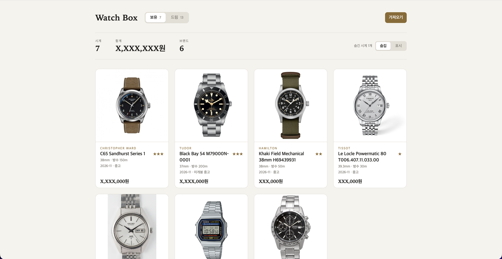

# Watch Box



보유 시계와 드림 워치(갖고 싶은 시계)를 정리하는 크롬 확장 프로그램. by OBJECT_a

컴퓨터의 크롬 전용이며 모바일은 지원하지 않는다.

- 시계별 사양, 가격, 구매·판매 정보, 이미지, 메모 관리
- ChatGPT·Claude·Gemini 등 AI가 정리해 준 JSON을 붙여넣어 시계 추가
- 선호도·가격대·브랜드로 걸러 보기, 숨기기
- 서버 없음 — 시계 정보는 크롬 계정 동기화에, 이미지는 기기에 저장

## 설치

### 1. 직접 설치

1. [릴리스](../../releases/latest)에서 `watch-box-<버전>.zip` 을 받는다.
2. zip의 압축을 풀면 `watch-box` 폴더가 나온다.
3. `watch-box` 폴더를 계속 둘 곳으로 옮긴다. 위치는 자유지만 크롬이 이 폴더를 계속 읽으므로, 지우거나 옮기지 않을 곳에 둔다.
4. 크롬에서 `chrome://extensions` 를 열고 오른쪽 위 **개발자 모드**를 켠다.
5. **압축해제된 확장 프로그램을 로드합니다**를 누르고 옮겨 둔 `watch-box` 폴더를 고른다.
6. 툴바의 Watch Box 아이콘을 누르면 관리 페이지가 열린다.

### 2. AI 프롬프트로 설치 가이드

위 직접 설치가 어렵다면 다음 프롬프트를 복사해 ChatGPT·Claude·Gemini 등 AI에 붙여넣는다. 설치와 업데이트를 한 단계씩 안내받을 수 있다.

```text
크롬 확장 프로그램 "Watch Box"를 내 컴퓨터에 설치(또는 업데이트)하려고 해. 나는 컴퓨터를 잘 모르니까, 아래 [해야 할 일]을 한 단계씩 따라 할 수 있게 안내해 줘.

안내 방법:
- 먼저 내 컴퓨터가 윈도우인지 맥인지, 처음 설치인지 업데이트인지 물어볼 것
- 한 번에 한 단계만 알려 주고, 내가 "다음"이라고 하면 다음 단계로 넘어갈 것
- 단계마다 어디에서 무엇을 누르는지 그대로 적어 줄 것
- 내가 화면이 다르다거나 오류가 났다고 하면, 지금 보이는 글자를 물어보고 맞춰서 안내할 것
- 터미널이나 PowerShell 같은 명령 입력은 시키지 말 것. 아래 순서는 마우스만으로 끝남
- 압축 푸는 방법처럼 컴퓨터마다 다른 부분은 내 컴퓨터에 맞게 풀어서 알려 줄 것
- 아래에 없는 내용은 지어내지 말 것

[알아 둘 것]
- Watch Box는 컴퓨터의 크롬에서만 쓸 수 있음. 휴대폰(안드로이드·iOS)은 지원하지 않음
- 크롬 웹 스토어에 없는 확장 프로그램이라, 파일을 받아 크롬의 개발자 모드로 직접 불러와야 함
- 받는 곳: https://github.com/paki1019/watch-box/releases/latest
- 시계 정보와 이미지는 크롬 안에 저장됨. watch-box 폴더에는 프로그램 파일만 있어서, 업데이트하며 폴더를 지워도 데이터는 남음

[해야 할 일 — 처음 설치]
1. 위 주소를 열고 Assets 목록에서 watch-box-(버전).zip 하나만 받기. install.sh, install.ps1 은 받지 않아도 됨
2. 받은 zip의 압축을 풀기. watch-box 폴더가 나옴
3. watch-box 폴더를 계속 둘 곳으로 옮기기. 위치는 어디든 되지만, 크롬이 이 폴더를 계속 읽으므로 지우거나 옮기지 않을 곳이어야 함. 다운로드 폴더에 그대로 두는 것은 권하지 않음 (정리하다 지우기 쉬움). 어디에 둘지 나에게 물어보고, 내가 모르겠다고 하면 문서 폴더를 권할 것
4. 크롬 주소창에 chrome://extensions 를 입력해 열고, 오른쪽 위의 "개발자 모드"를 켜기
5. 왼쪽 위에 생긴 "압축해제된 확장 프로그램을 로드합니다"를 누르고, 3에서 옮겨 둔 watch-box 폴더를 고르기. 폴더 안으로 들어가지 말고 watch-box 폴더 자체를 고를 것
6. 크롬 오른쪽 위 퍼즐 조각 아이콘을 눌러 Watch Box를 찾고, 핀을 눌러 툴바에 고정하기. 아이콘을 누르면 Watch Box가 열림

[해야 할 일 — 업데이트]
1. 위 주소에서 새 watch-box-(버전).zip 받기
2. 새 zip의 압축을 풀기. 새 watch-box 폴더가 나옴
3. 설치할 때 둔 기존 watch-box 폴더를 지우고, 새 watch-box 폴더를 그 자리에 두기. 위치와 폴더 이름이 전과 같아야 함
   - 기존 폴더가 어디 있는지 모르면: chrome://extensions 에서 Watch Box 카드의 "세부정보"를 누르면 "소스" 항목에 폴더 위치가 나옴
4. chrome://extensions 에서 Watch Box 카드의 새로고침(↻) 누르기
- 저장한 시계와 이미지는 그대로 남음

[자주 막히는 곳]
- "매니페스트 파일이 없거나 읽을 수 없습니다": 고른 폴더가 틀림. manifest.json 파일이 바로 들어 있는 watch-box 폴더를 골라야 함. zip 파일 자체나 한 단계 위 폴더를 고르면 안 됨
- 압축을 풀었더니 watch-box-(버전) 폴더가 나옴: 그 안에 watch-box 폴더가 들어 있음. 안쪽 watch-box 폴더를 쓰면 됨
- 압축을 풀었더니 watch-box 2 처럼 숫자가 붙은 폴더가 나옴: 같은 자리에 watch-box 폴더가 이미 있었던 것. 폴더 이름을 watch-box 로 맞춰서 쓸 것
- 크롬을 켤 때 "개발자 모드 확장 프로그램 사용 중지" 안내가 뜸: 직접 불러온 확장 프로그램이라 뜨는 안내. 닫으면 되고, 사용 중지를 누르지 말 것
- 개발자 모드를 끄면 Watch Box도 꺼짐. 켠 채로 둘 것
- watch-box 폴더를 옮기거나 이름을 바꾸면 Watch Box가 사라짐. 업데이트할 때 말고는 그대로 둘 것
- chrome://extensions 에서 Watch Box를 "삭제"하면 기기에 받아 둔 이미지는 지워짐. 다시 설치하면 이미지 주소로 다시 받아 옴
- 그래도 안 되면 https://github.com/paki1019/watch-box/issues 에 남기거나 paki1019@gmail.com 으로 문의
```

## 업데이트

1. 새 릴리스의 zip을 받아 압축을 푼다.
2. 기존 `watch-box` 폴더를 지우고, 새 `watch-box` 폴더를 같은 자리에 둔다. 기존 폴더 위치는 `chrome://extensions` → Watch Box **세부정보** → **소스**에서 볼 수 있다.
3. `chrome://extensions` 에서 Watch Box 카드의 새로고침(↻)을 누른다.

저장한 시계와 이미지는 유지된다. 시계 정보와 이미지는 크롬 안에 저장되고 `watch-box` 폴더에는 프로그램 파일만 있다. 확장 프로그램을 **제거**하면 기기에 받아 둔 이미지는 지워지고, 다시 설치하면 이미지 주소로 다시 받아 온다.

### 설치 스크립트 (선택)

터미널이 익숙하면 릴리스의 설치 스크립트를 zip과 같은 폴더에 받아 실행해도 된다. 설치 폴더를 물어보며, 같은 폴더에 다시 실행하면 업데이트된다.

- mac · Linux: `bash install.sh` (기본 `~/Applications/watch-box`)
- Windows: `powershell -ExecutionPolicy Bypass -File install.ps1` (기본 `%LOCALAPPDATA%\watch-box`)

## 처음 쓰기

1. **가져오기** → **프롬프트 복사** → 보유·드림 중 선택
2. 웹 검색이 되는 AI(ChatGPT·Claude·Gemini 등)에 시계 이름을 적고, 그 아래에 프롬프트를 붙여넣어 보내기
3. 출력된 JSON을 가져오기 창에 붙여넣고 **저장**

기본 사용법은 왼쪽 위 **Watch Box** → **도움말**에 있다. 자세한 사용법은 아래처럼 AI에 물어본다.

### AI에게 사용법 물어보기

도움말 창에는 기본 사용법만 보인다. 이미지 고르기, 숨기기, 동기화, GitHub 스토리지, 업데이트 같은 자세한 내용은 **도움말 프롬프트**에 들어 있다.

1. 왼쪽 위 **Watch Box** → **도움말** → **도움말 프롬프트 복사**
2. ChatGPT·Claude·Gemini 등 AI에 붙여넣어 보내기
3. AI가 Watch Box를 짧게 소개하고 처음 할 일을 알려 준 뒤 질문을 받는다. 궁금한 것을 이어서 물어본다

- 프롬프트에는 설치된 버전 기준의 전체 도움말이 담긴다. 업데이트 후에는 새로 복사해서 쓴다.
- AI는 도움말에 있는 내용으로만 답하고, 화면의 버튼 이름도 그대로 쓴다. 도움말에 없는 기능을 물으면 없다고 답하고 [문의](#문의) 창구를 알려 주며, 원하면 문의 글 초안도 써 준다.

## 데이터와 권한

- 시계 정보는 크롬 동기화 저장소에 저장되어, 같은 크롬 계정으로 로그인한 기기끼리 공유된다. 용량은 약 100KB이며 사용량은 **Watch Box** 제목 → **동기화** 줄을 누르면 보인다.
- 이미지는 주소만 동기화되고 파일은 각 기기에 저장된다. 다른 기기에서는 주소로 다시 받아 온다.
- 외부 서버로 보내는 정보는 없다. 이미지 주소에서 이미지를 받아 올 때만 해당 사이트에 접속한다.
- 권한: 저장소(`storage`, `unlimitedStorage`), 우클릭 메뉴(`contextMenus`), 이미지를 받아 오기 위한 https 사이트 접근.
- 고급 기능으로 GitHub 스토리지를 연결하면 시계 정보와 이미지 사본을 내 비공개 GitHub 저장소에 보관한다 (**Watch Box** 제목 → **동기화** 줄을 눌러 여는 동기화 설정). 용량 제한이 없어지고, 이때만 api.github.com 에 접속한다.
  - 연결에 쓴 GitHub 토큰은 암호화 없이 크롬 동기화 저장소에 저장되어, 같은 크롬 계정의 다른 기기에도 전달된다. 그 저장소 하나에만 권한을 준 토큰을 쓴다.
- 백업: **가져오기** 창의 맨 위 제목을 누르면 전체 시계가 JSON으로 복사된다. 파일로 보관했다가 가져오기 창에 붙여넣으면 복원된다.

## 문의

원하는 기능이 없거나 오류가 있으면 [GitHub Issues](https://github.com/paki1019/watch-box/issues)에 남기거나 paki1019@gmail.com 로 메일을 보낸다. 버전, 하려던 일, 실제로 일어난 일을 적는다.

## 상표

브랜드 로고와 상표는 각 소유자의 것이며, Watch Box는 해당 브랜드와 무관하다. 로고는 브랜드를 구분해 보여 주는 용도로만 쓴다.
